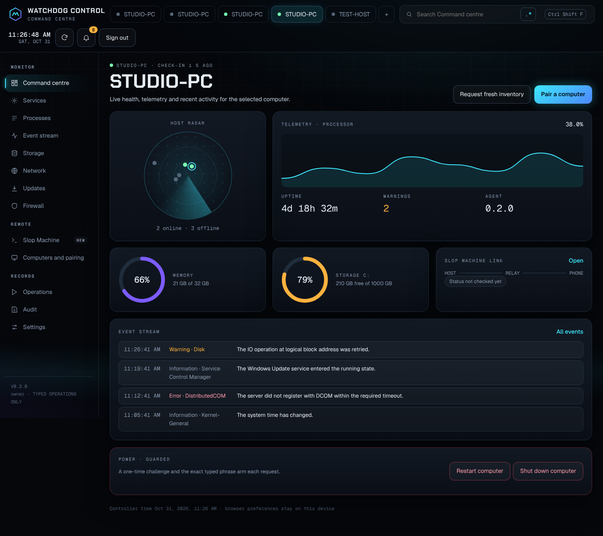
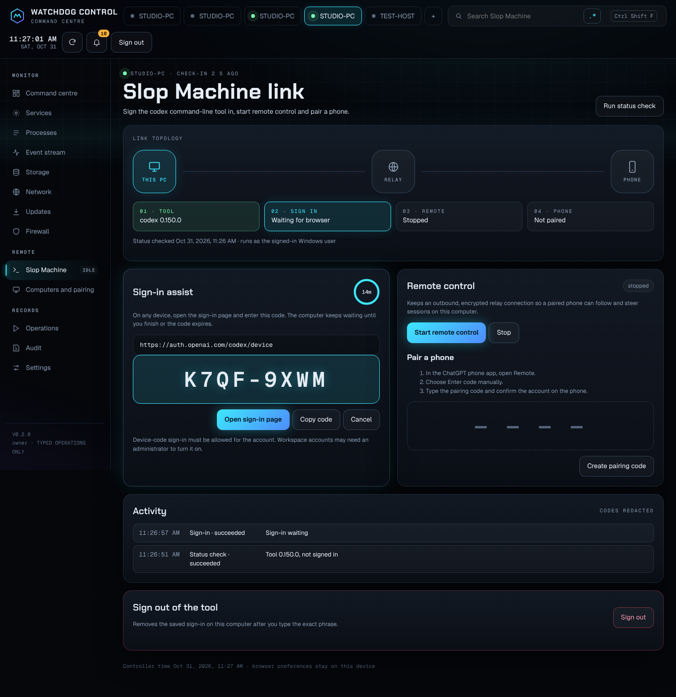
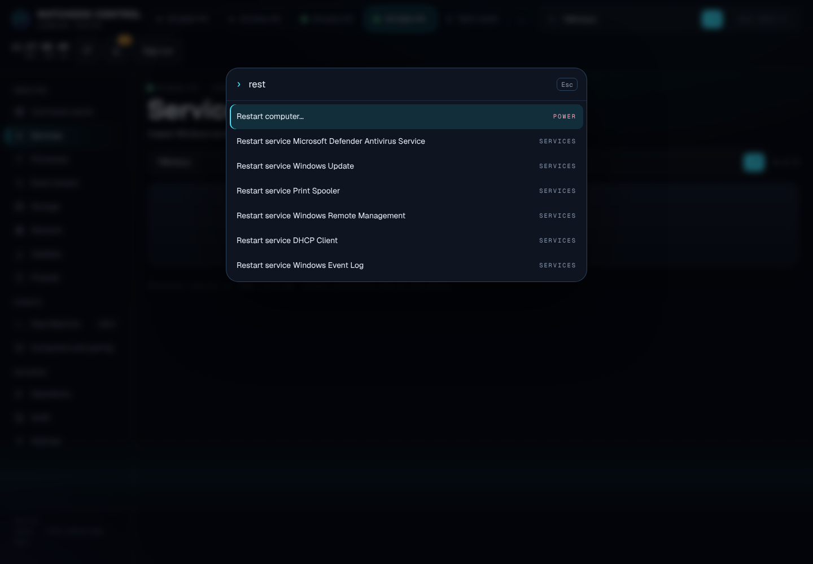
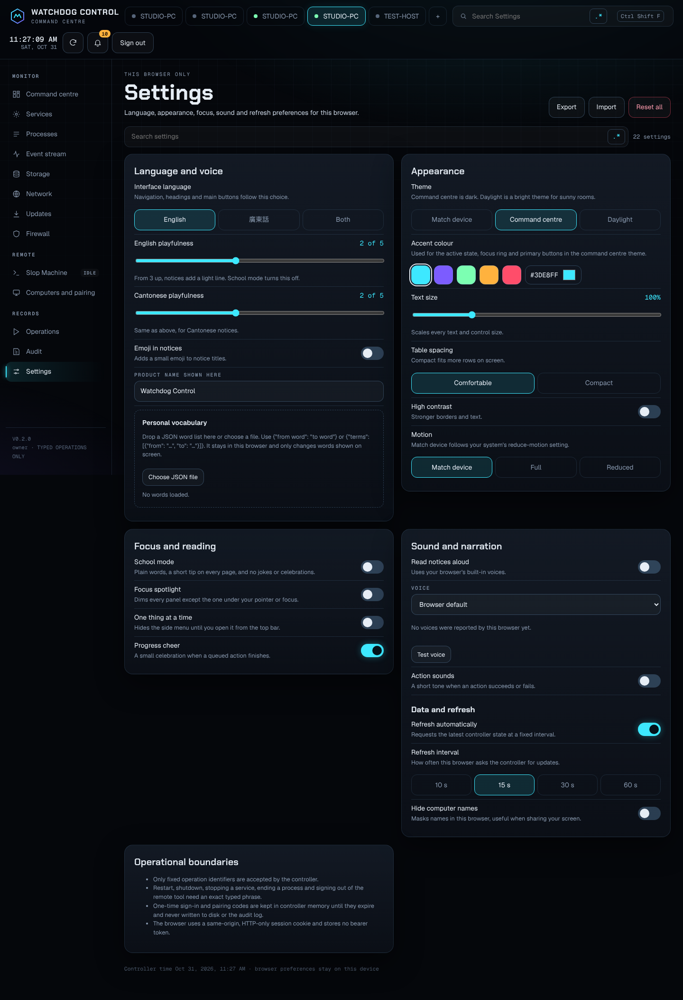
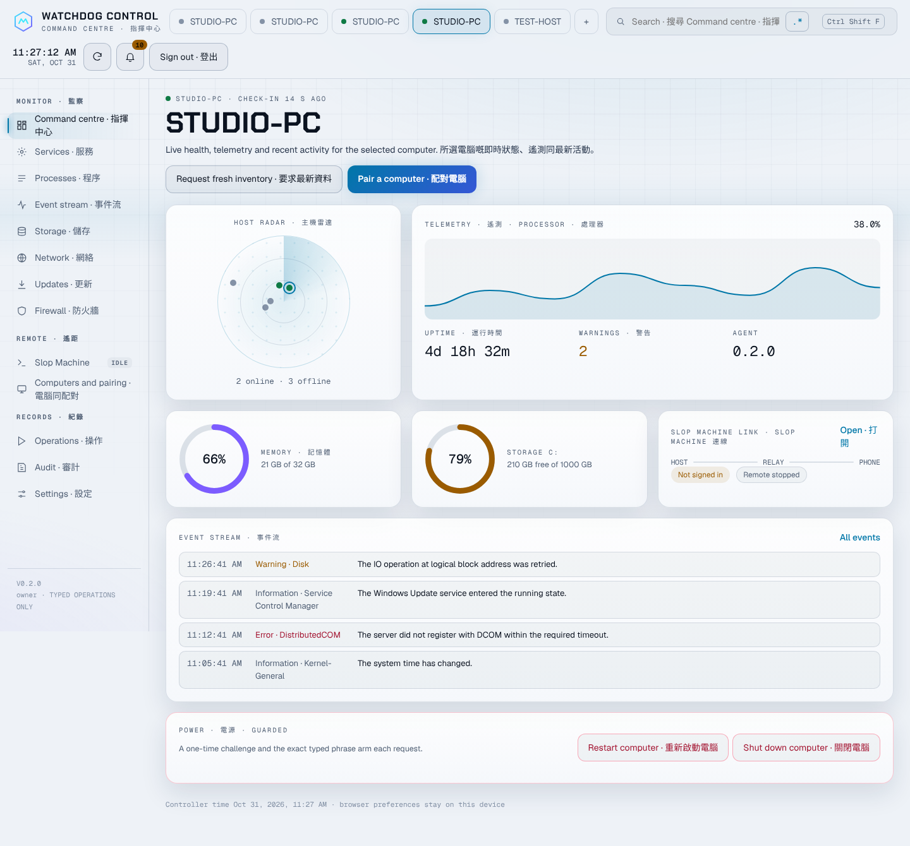
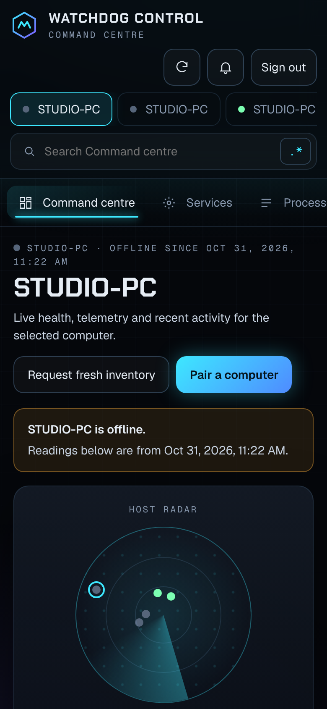
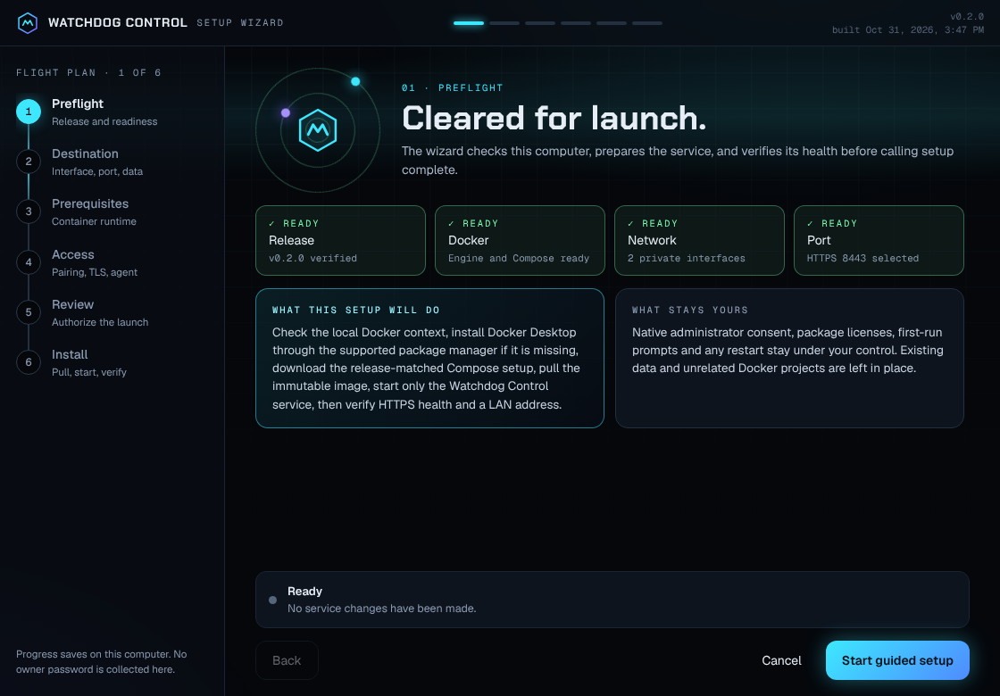
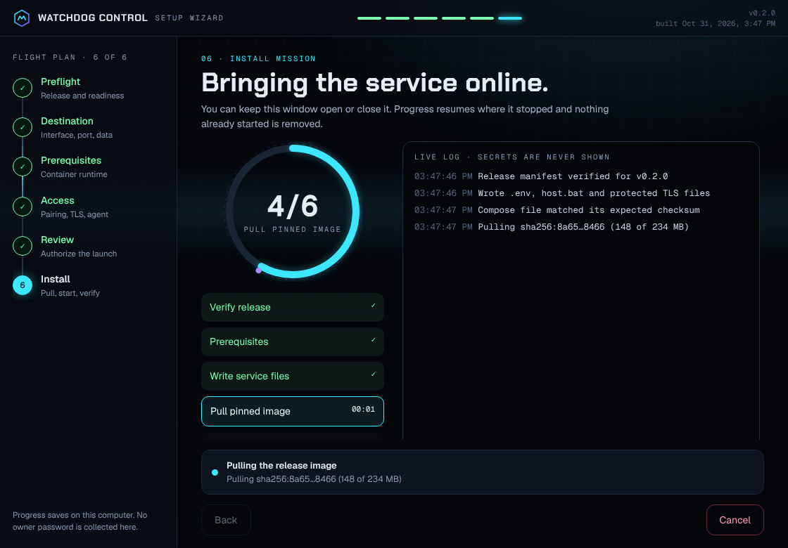

# Watchdog Control

Current development adds [native hosting, verified temporary access, protected Discord notifications and sign-in startup](docs/features/native-hosting.md). The portable setup build now bundles the native controller and hosting tools, so this route does not require Docker. Packaged and live runtime verification is pending. [Issue #3](https://github.com/Ding-Ding-Projects/watchdog-control/issues/3) hands the requested live chat-style PowerShell/CMD terminal to the designer.

[Documentation site](https://ding-ding-projects.github.io/watchdog-control/)

| Overview | Remote | Security | Operations | Documentation |
| --- | --- | --- | --- | --- |
| [Purpose](#purpose) | [Slop Machine remote control](#slop-machine-remote-control) | [Security model](docs/security/README.md) | [Run locally](docs/operations/README.md) | [documentation website source](docs/README.md) |

## Purpose

Watchdog Control is an open-source Windows host management dashboard with a LAN-accessible API. It covers practical host administration such as health, services, processes, event logs, storage, networking, updates, firewall state, and carefully confirmed power actions.

Host operations use typed actions and a documented operation catalog. The public API does not accept arbitrary shell text or caller-selected executables and paths. Authentication, authorization, audit records, and exact confirmations protect destructive actions. Computer restart and shutdown use a short-lived, single-use challenge. These paths are implemented in source; live host behavior remains unverified.

## Project state

The source includes the authenticated host API, Windows management agent, dashboard, tracked Compose deployment, `host.bat`, and a tailored portable single-file setup tool. Normal release `v0.1.1` is published for source `1e39ae2647ab8959867f8050a340f0a3a1421cf4`; its setup executable is 68,084,205 bytes with SHA-256 `f8154f0d6978c1b95175fab12ecfaa3bed378c94338205459f9bf4a36e2d3114`. The release includes the embedded-Compose integrity contract and the corrected environment-sample name.

The portable setup file embeds `compose.yaml` and exposes a one-click welcome-screen action. On the current host, the `v0.1.1` file was launched directly without installation; the GUI action wrote its protected service files, pulled the verified image, started the named Compose project, and returned HTTPS health HTTP 200. The container remained healthy when a concurrent setup-progress save caused the window to exit. Source now uses a unique temporary file for each progress write; release `v0.1.2` will carry that fix.

The updated `v0.1.2` single-file package and a current built-interface screenshot remain pending. Cross-device LAN reachability, owner authentication, host operations, and live documentation routes remain separate verification steps. The local host health result does not establish those behaviors.

## Slop Machine remote control

The **Slop Machine** page drives the `codex` command-line tool on a paired computer: a status check,
device-code sign-in assist with the one-time code and a countdown, remote control start and stop,
and a phone pairing code for the ChatGPT phone app. Every command is fixed in the agent, signing out
needs a typed phrase, and one-time codes stay in controller memory instead of the data file or audit
log. See [Slop Machine remote control](docs/features/remote-agent.md). Running it on a real Windows
host is not verified yet.

## Command centre dashboard

Version 0.2.0 redesigns every interface as a command centre: host radar, live telemetry, animated
gauges, a command palette (`Ctrl+Shift+F`), a regex builder on every search, context menus, a
notification centre, and settings for language (English, Cantonese or both), theme, accent colour,
text size, contrast, motion, focus modes, narration and sounds. See
[Dashboard experience](docs/features/dashboard-experience.md) and the design reference in
[`design/redesign-2026-10`](design/redesign-2026-10/README.md).

## One-click setup and hosting

`WatchdogControlSetup.exe` is a self-contained portable setup tool. It embeds `compose.yaml`, verifies its SHA-256 against the selected release manifest, and offers **Host Watchdog Control on this computer** on the welcome screen. The executable launches without installation. On a computer with an already-ready local Docker Engine and Compose plugin, that action pulls the release-pinned image, writes only this service's configuration and protected local files, starts the Watchdog Control project, and checks HTTPS health and the selected LAN URL. It installs no additional software on this ready-engine path.

For an existing service folder, exact matches of `compose.yaml`, `.env`, `host.bat`, and `scripts/host.ps1` are reused. Differing files require confirmation after byte-for-byte backups are verified; declining or a concurrent file change preserves the existing file.

When interface choice, host port, saved data location, or prerequisite recovery needs attention, use the guided setup steps. The assistant keeps native consent and any required restart under the operator's control. See [the complete setup workflow](docs/features/setup-assistant.md) for prerequisites, recovery, integrity checks, and current verification state.

Double-clicking `host.bat` opens a keyboard menu. If no choice is made within eight seconds, it starts or updates the service and returns after health checks. `host.bat --detached` starts and verifies in the background, `host.bat --logs` opens the interactive log view, and `host.bat --stop` is the separate explicit stop action.

## Screenshots

These are genuine captures of the rebuilt dashboard running against a local development controller
with a test agent supplying readings. They are not captures of a Windows host.

| Command centre | Slop Machine sign-in assist |
| --- | --- |
|  |  |

| Command palette | Settings |
| --- | --- |
|  |  |

| Daylight theme, English and Cantonese | Phone |
| --- | --- |
|  |  |

| Desktop setup wizard preflight | Desktop setup wizard install mission |
| --- | --- |
|  |  |

The desktop setup wizard captures come from its renderer in Chrome with a mock bridge. The setup assistant windows have not been captured on Windows yet.

## Local publication checks

Configure the repository-local hooks with `git config --local core.hooksPath .githooks`. The pre-commit hook scans staged content; the pre-push hook scans outgoing revisions against the selected GitHub remote. They use a locally installed publication policy when available. If that policy source is present but the trusted runner cannot start, the operation stops. Clones without the private policy source skip this owner-specific scan; the hosted publication-language workflow remains the shared enforcement route.

## Navigation

- [Roadmap](ROADMAP.md)
- [Handoff](HANDOFF.md)
- [Architecture](docs/architecture/README.md)
- [Security](docs/security/README.md)
- [Operations](docs/operations/README.md)
- [Feature documentation](docs/features/README.md)
- [Slop Machine remote control](docs/features/remote-agent.md)
- [Dashboard experience](docs/features/dashboard-experience.md)
- [Wiki source inventory](docs/wiki/README.md)
