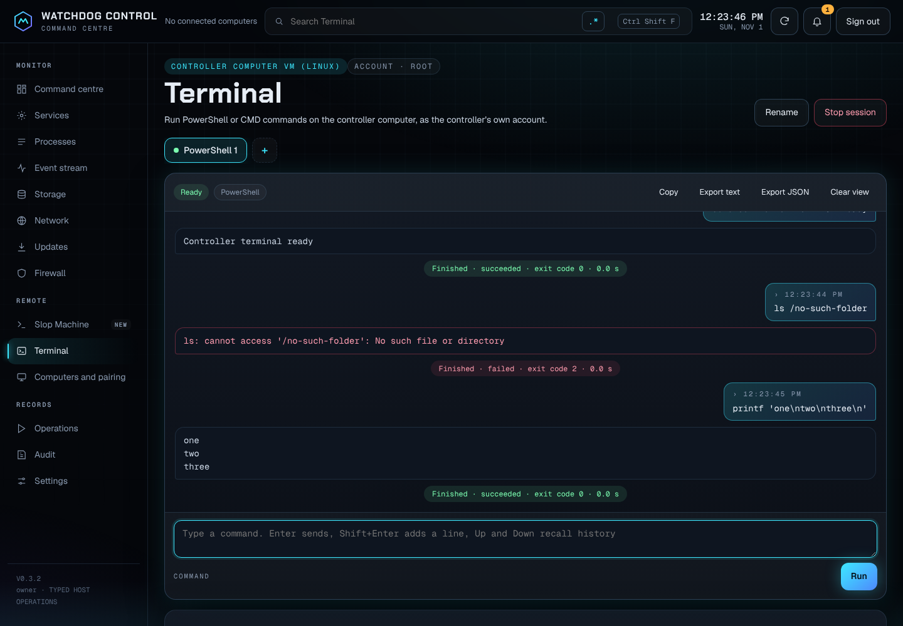
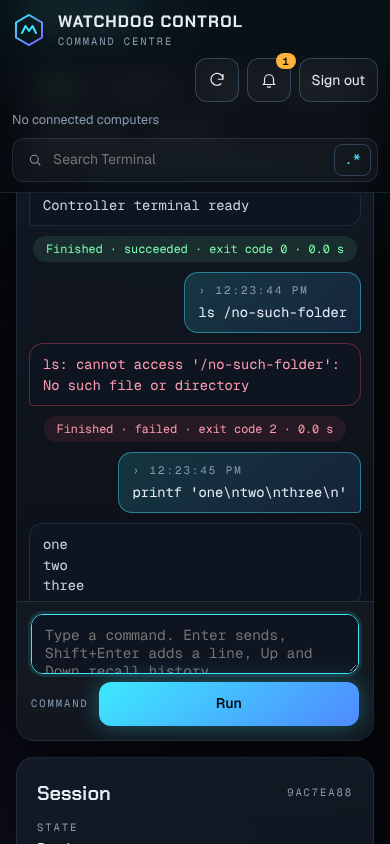

# Controller terminal

The Terminal page in the dashboard runs PowerShell or CMD commands on the **controller computer**,
using the controller's own account. It is a chat-style transcript: each command you send appears on
the right, its output below it, and a result line shows whether it succeeded and its exit code.
It was requested in [issue #3](https://github.com/Ding-Ding-Projects/watchdog-control/issues/3) and
follows the design in `design/terminal-2026-10/`.

The screenshots above and below come from a Linux development controller where PowerShell is not
installed. A test stand-in shell was used to drive the page, so the commands shown are Linux
commands; on a Windows controller the PowerShell and CMD sessions run the real shells.

## What it can and cannot reach

- Commands run on the computer that runs the controller, never on paired computers. Paired
  computers still accept only typed operations.
- When the controller runs in a container, sessions run inside that container, and the page says so.
- Commands run with the controller account's rights. Nothing is elevated, and no consent prompt is
  answered for you.
- Full-screen console programs (editors, pagers, interactive menus) are not supported.

## Who can use it and from where

- Only the signed-in owner. Each owner sees only their own sessions.
- Only from a browser connected directly over the local network. Requests that arrive through
  temporary public access, a tunnel or any proxy are refused with `terminal-local-network-only`,
  because tunnel traffic reaches the controller from loopback and would otherwise pass the
  private-address check.
- Writes require the same-origin session cookie, like the rest of the dashboard.
- Set `WATCHDOG_TERMINAL=disabled` in the controller environment to turn the feature off.

## Using it

1. Open **Terminal**. The page shows where commands run, the account, and which shells are
   available, with a reason for any that are not.
2. Choose **Start PowerShell** or **Start CMD**. Up to four sessions can be open at once; each gets
   a tab you can rename.
3. Type a command and press **Enter**. **Shift+Enter** adds a line. **Up** and **Down** recall this
   session's history.
4. While a command is running, the box sends what you type to that program's standard input.
5. **Stop session** ends the shell and every program it started, after confirmation. There is no
   separate cancel for a single command.

The top search box filters the transcript, with the regular expression builder beside it. **Copy**,
**Export text** and **Export JSON** use this browser's copy of the transcript. **Clear view** only
clears this browser's view.

## Limits and records

| Limit | Value |
| --- | --- |
| Sessions per owner | 4 |
| Input per send | 16 KB |
| Output kept per session | 2 million characters; the oldest output is dropped with a marker |
| Idle stop | 15 minutes without activity |
| Session lifetime | 8 hours |

Sessions live in controller memory and end when the controller stops. Command text and output are
never written to the controller log, the data file or the audit log. The audit log records only
`terminal.session.started`, `terminal.session.stopped` and `terminal.session.expired`.

## API

| Request | Purpose |
| --- | --- |
| `GET /api/terminal/capabilities` | Computer, platform, account, container flag, shells and limits |
| `GET /api/terminal/sessions` | The owner's sessions |
| `POST /api/terminal/sessions` `{ "shell": "powershell" \| "cmd", "name"? }` | Start a session |
| `GET /api/terminal/sessions/{id}?after=N&wait=true` | Events after sequence N; `wait` holds the request up to 20 seconds for new output |
| `POST /api/terminal/sessions/{id}/input` `{ "text": "...", "mode": "command" \| "stdin" }` | Run a command or write standard input |
| `PATCH /api/terminal/sessions/{id}` `{ "name": "..." }` | Rename |
| `DELETE /api/terminal/sessions/{id}?forget=true` | Stop the session and its process tree; `forget` also removes it from the list |

## Verification state

- Verified on a Linux development controller (2026-11-01): route authentication, cross-origin
  refusal, refusal through tunnel and proxy headers and tunnel host names, session start, output,
  error output, exit codes, standard input, history, search, rename, multiple tabs, stop, phone
  layout without horizontal scrolling, text-only rendering of output, and absence of command text
  from the log, data file and audit.
- **Not verified:** real PowerShell or CMD sessions on a Windows controller, the container image
  (which does not include PowerShell), and long-running or high-volume output.
