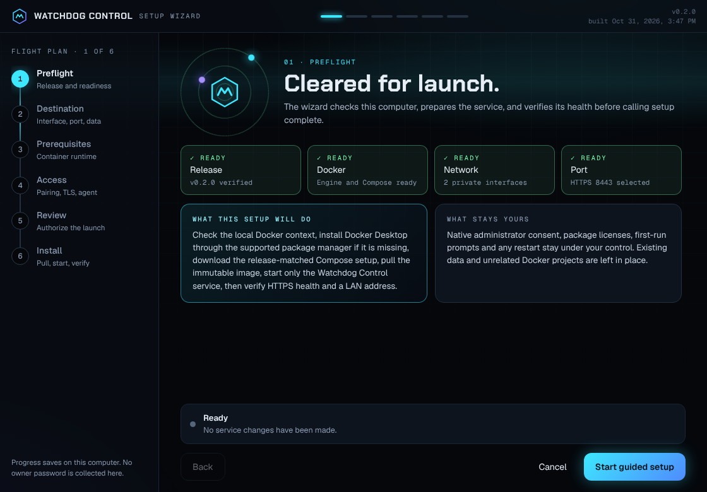
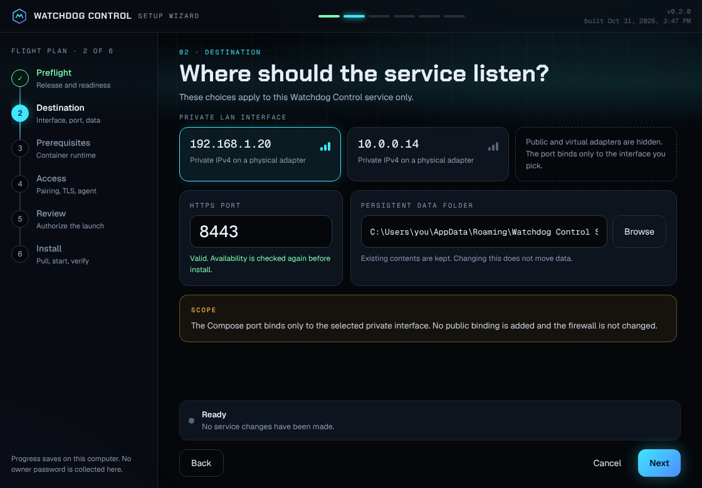
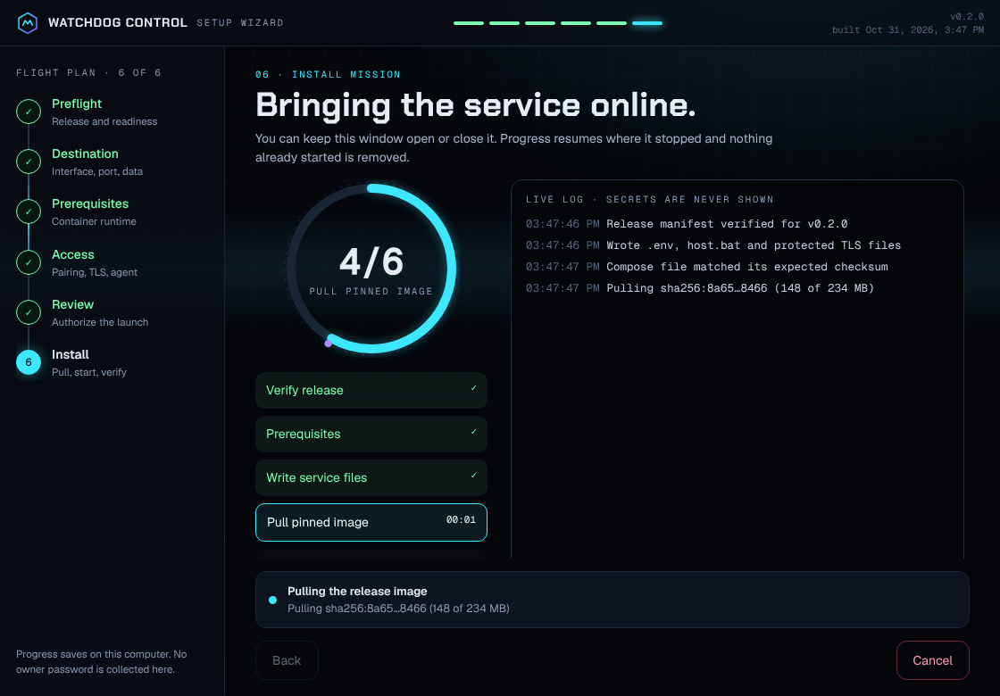
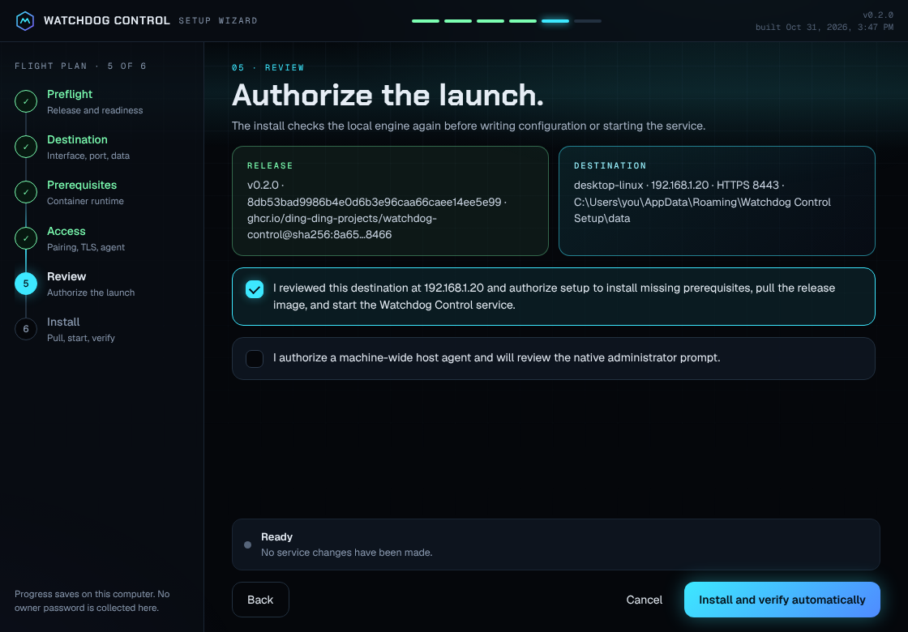
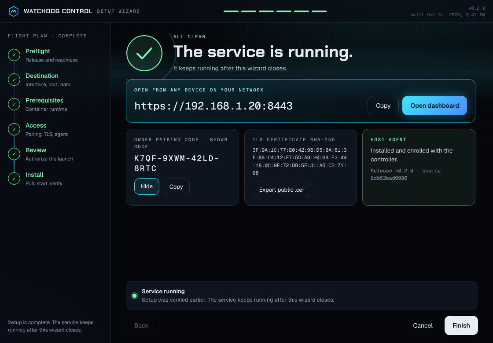
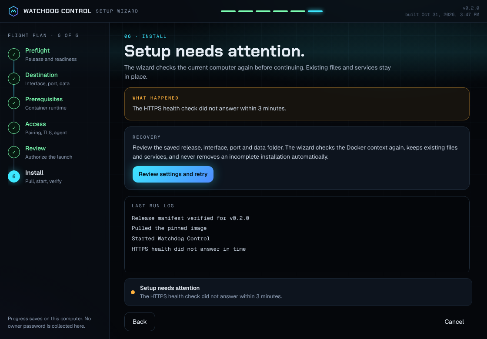

# Historical hosting evidence before the 0.3.2 candidate

This archive preserves the earlier records as they stood at source `d131c72f752f1fd62019fcc9f6bc18f58e081bf9`. Statements such as current, pending, and unverified below describe that historical record, not present acceptance. Screenshot capture dates were not established by this archive.

The setup wizard images below were captured from its renderer in Chrome using a mock bridge. They are historical design/renderer evidence, not native installation or current packaged-runtime proof. Original image files are retained unchanged; relative links are rebased for this archive. Dashboard captures retain their separate development-controller/test-agent provenance in the main README.

## Earlier handoff

### Handoff

## Hosting checkpoint, 2026-10-31

The native/Compose hosting implementation and lifecycle repairs are preserved through `f285a8a90569aefeb1d972e412e232895fa554fb`, verified on its remote task branch. Sixteen focused checks passed and independent source review found the recorded defects resolved. The packaging checkpoint switches the root scripts to the existing portable desktop assistant and bundles the native controller, Node.js and pinned cloudflared. Its build, real setup, tunnel recovery, startup registration and webhook delivery still need verification. See [the hosting workflow](../features/native-hosting.md) and [current continuation checkpoint](../../CLOSEOUT_PROMPT.md).

The owner explicitly handed terminal interface design to the design tool through [issue #3](https://github.com/Ding-Ding-Projects/watchdog-control/issues/3). No terminal design was authored here. The endpoint table is a proposal and must not be described as an implemented API.

## Current state

Version 0.2.0 adds Slop Machine remote control and a command centre redesign of every interface.

- **Remote control.** The agent now runs the `codex` command-line tool through seven fixed operations (`codex.status`, `codex.login.start`, `codex.login.cancel`, `codex.logout`, `codex.remote.start`, `codex.remote.stop`, `codex.remote.pair`). By default it launches the tool as the console user through `CreateProcessAsUser`; `codex.json` in the protected agent data folder can select the service account, a fixed executable path or a data folder. The controller keeps one-time sign-in and pairing codes in memory only and redacts them everywhere else. New route: `GET /api/hosts/{hostId}/codex`.
- **Redesign.** The dashboard, setup assistant and documentation site share the command centre design recorded in `design/redesign-2026-10`. Fonts are vendored. `/health` now reports the version.
- **Evidence.** All three projects build with the pinned SDK (`dotnet build`, Windows targeting enabled on Linux). A local development controller passed an end-to-end remote check (status, sign-in, start, pair, typed sign-out, rejected targets and unknown actions, and no code on disk, in the audit log or in the dashboard feed). The dashboard was driven in Chrome and captured; captures are in `docs/assets/screens`.
- **Not verified.** Nothing in this release has run on a Windows host yet: the remote operations, the console-user launch path, the redesigned setup assistant window, and the v0.1.2 progress-save fix carried into this version all remain unverified there.

## Earlier state (v0.1.x)

The public repository `Ding-Ding-Projects/watchdog-control` is on local and hosted `main` at `453c0a64aded8d96961af4b5618df4bb053f2414` before the current uncommitted changes. Normal release `v0.1.1` targets `1e39ae2647ab8959867f8050a340f0a3a1421cf4` and is neither draft nor prerelease.

The release asset `WatchdogControlSetup.exe` is 68,084,205 bytes with SHA-256 `f8154f0d6978c1b95175fab12ecfaa3bed378c94338205459f9bf4a36e2d3114`. It includes the bundled `compose.yaml` integrity check. On the current host, it launched without installation and its welcome-screen action pulled the verified image, wrote the service configuration, started only the Watchdog Control Compose project, and returned HTTPS health HTTP 200. The container remained healthy after the setup window exited on a concurrent write to `progress.json.tmp`.

The current source gives every progress save a unique temporary file before atomically replacing the destination. The version is set to `0.1.2`. A focused 32-writer concurrency check has been added but not run. The current source, new single-file package, post-fix GUI launch, and usable built-interface capture remain unverified. An earlier white capture was rejected and is not current evidence.

## Current evidence

- Normal release `v0.1.1` exists for source `1e39ae2647ab8959867f8050a340f0a3a1421cf4` with the expected setup file, Compose, host controls, image archive, manifest, and checksums.
- The released setup file completed the one-click host operation through its real welcome-screen button without installing software on a computer with an already-ready local engine.
- The service passed its local HTTPS health check with HTTP 200 and Docker reported the container healthy.
- The setup window crashed after hosting while concurrent progress writers contended for a shared temporary path. The source fix is present locally and still needs a rebuilt package and runtime confirmation.
- A read-only audit of current public records covered the open issue, its 17 comments, the progress Discussion and its 20 comments/replies, both releases, and the deployed documentation home with five same-origin assets. It found 16 wording findings across nine authored comments. Those comment bodies still need correction and exact readback before the public-record review can close.
- Cross-device LAN access, owner pairing, client certificate trust, agent enrollment, typed host operations, and native prerequisite installation remain unverified.
- Public documentation contains the v0.1.1 runtime result and labels the new fix and package as pending. The current screenshot and hosted documentation readback remain pending.
- Automated tests have not run; they remain reserved for after implementation and functional acceptance.

## Next actions

0. On a Windows host with the codex tool installed, run the Slop Machine page end to end: status, sign-in, remote control start, pairing, stop and sign-out, and capture the redesigned setup assistant window.
1. Finish the source and documentation review and run the publication-language scan.
2. Preserve the reviewed source and documentation on `main`, then run the exact root `build-installer.bat` entrypoint.
3. Launch the resulting single-file setup tool on a fresh named hidden desktop, inspect the actual window, and capture only genuine, readable pixels without authentication values.
4. Verify that saved progress loads and the setup window stays open after the already-running service is recognized. Do not start another container when the existing service is healthy.
5. Complete the requested local acceptance, then run the 32-writer concurrency check last. Update the final records from actual outputs.
6. Correct the nine authored public comments found by the read-only audit, reread their stored bodies, and record any platform edit-history limit.
7. push the final `main` state, verify `git ls-remote`, then read back the normal v0.1.2 release, assets, immutable image, and deployed documentation routes.

The current service remains running. No computer shutdown or restart was initiated. Preserve unrelated containers, volumes, files, authentication, and user configuration. Use only GitHub CLI for forge work and do not rewrite history.

## Earlier setup article and original screenshot references

### Automatic setup assistant

## Current hosting expansion

The current source selects native Windows hosting by default, with Docker Compose as an explicit alternative. It adds temporary Cloudflare access, protected Discord webhook configuration and current-user sign-in startup. See [native hosting and temporary access](../features/native-hosting.md) for behavior and the exact pending verification. The historical release evidence below describes earlier packages and does not prove this new flow.

**The normal `v0.1.1` release is published.** Its portable setup file is 68,084,205 bytes with SHA-256 `f8154f0d6978c1b95175fab12ecfaa3bed378c94338205459f9bf4a36e2d3114`; it embeds `compose.yaml`. The local `v0.1.1` file was launched without installation and its welcome-screen host action pulled the verified image, wrote its service files, started the named Compose project, and passed HTTPS health on the selected LAN address. The container remained healthy after the setup window hit a concurrent progress-save failure. The source now gives each state write a unique temporary file; the fix, updated `v0.1.2` package, and rebuilt interface still need verification. Current screenshots are pending because the earlier capture was blank.

## One-click hosting from the welcome screen

The welcome screen includes **Host Watchdog Control on this computer**. Clicking it is the explicit start confirmation and begins the bounded setup and health-check workflow without opening each guided step. The setup file is portable and single-file, so it can be launched directly from a download folder or removable storage without installing the setup application.

This quick route uses an already-ready local Docker Engine and Compose plugin. It downloads the verified Watchdog Control image and writes this service's configuration and protected local files. It does not install the assistant, Docker Desktop, another runtime, the optional host agent, or other host prerequisites. Before enabling the action, the assistant checks that a verified normal release manifest is available, the selected private LAN interface is unambiguous, the HTTPS port is valid and available when first starting, and the saved data folder does not require recovery confirmation. The welcome screen shows the destination URL and data folder. If a check is not satisfied, the action stays disabled and explains the next setup step.

The assistant contains `compose.yaml` as an embedded resource. It verifies the embedded file's SHA-256 against `service.composeSha256` in the selected release manifest before writing the host copy and starting the named project. The quick route still pulls the immutable image and writes service configuration and protected local files. A previously started service remains available to the retry path; quick hosting never removes unrelated projects or existing data.

The assistant compares the planned `compose.yaml`, `.env`, `host.bat`, and `scripts/host.ps1` bytes with files already in the service folder. Exact matches are reused. If any differ, a confirmation lists only the affected files; the assistant writes and verifies byte-for-byte backups before replacing those files. Choosing No leaves the differing files untouched. A file that changes during setup is preserved and blocks replacement. Failed writes roll back files changed in that operation when their contents still match the staged version, and retain verified backups for recovery.

## Guided setup

## Start or resume setup

1. Review the latest normal product release. The assistant verifies its release manifest, source tag, immutable image digest, embedded Compose checksum, and expected download metadata before continuing.
2. Choose an active private LAN IPv4 interface, an unused HTTPS host port, and a persistent data folder. The review step shows the HTTPS URL for that exact address. The assistant saves these choices locally so setup can resume after first-run prompts or a manually completed restart.
3. Review the current Docker context. The setup requires a local Windows engine because it creates the certificate, pairing files, data folder, and optional host-agent enrollment material on this computer.
4. On the review step, confirm the target computer and select **Install and verify automatically**. The assistant then installs missing supported prerequisites, pulls the release image, starts the service, and runs its health checks. Installing the optional machine-wide host agent requires separate consent.
5. Complete any package license, first-run, or native administrator prompt shown by the supported installers. If the operating system requires a restart, perform it manually and reopen the same assistant. Choose **Review settings and retry** to resume from saved progress.
6. The assistant verifies the embedded Compose file, pulls the immutable image, creates or reuses protected local TLS and pairing material, starts only its named project, checks pinned-certificate HTTPS health on the selected LAN address, and verifies the final LAN URL from the host.
7. At completion, check the pinned-certificate HTTPS health result from the selected LAN address, the final selected LAN URL, release tag, source revision, image digest, and certificate fingerprint. Export the public certificate and trust it on each client before entering the first owner credentials.

The setup application never starts a computer restart, changes sign-in or power settings, changes the host firewall, exposes the service on every interface, removes another Compose project, deletes existing service data, or accepts arbitrary shell text. The published service port is bound only to the selected active private LAN address.

## How missing container prerequisites are handled

When no local Docker Engine and Compose plugin are ready, the assistant checks the current user's App Installer registration. It first asks Windows to register the built-in package through Microsoft's documented registration command. If the package is not present, the assistant reads the latest stable release from Microsoft's public Windows Package Manager release feed, rejects drafts and prereleases, and requires the exact bundle, dependency manifest, and dependency archive with bounded sizes and SHA-256 digests from the release metadata.

The assistant downloads those assets over HTTPS into its application-specific local cache, verifies their digests, extracts only the x64 packages named by the dependency manifest, and installs the App Installer bundle for the current user with Windows package deployment. Windows validates the package signatures. The assistant then verifies the package family, Microsoft publisher identity, installed version, and `winget --version` result before starting the exact Docker Desktop package from the `winget` source.

The Docker package installation remains interactive. The assistant does not silently accept the Docker package's license, force administrator elevation, change PATH, or restart the computer. Docker Desktop starts after installation so its first-run or license screen can be completed by the user. Microsoft's current Windows guidance recommends per-user installation for ordinary use; that mode does not require administrator rights, while enabling WSL 2 for the first time can require administrator approval. See [Microsoft's WinGet installation guidance](https://learn.microsoft.com/en-us/windows/package-manager/winget/) and [Docker Desktop's Windows installation guidance](https://docs.docker.com/desktop/setup/install/windows-install/).

After the local engine is reachable, the assistant rechecks the active context and proceeds only when its endpoint is a local Windows named pipe. A remote or non-Windows context is not accepted.

## Saved setup state and privacy

The progress record holds setup choices, release identity, and the last completed step in the current Windows user's local profile. It does not hold the owner password. Pairing and certificate material are stored separately with user-only file permissions; the assistant does not write credentials or request bodies to its progress log. Successfully provisioned App Installer downloads are removed from the temporary cache. A failed provisioning attempt may retain verified downloads for a retry.

The optional Windows host agent is downloaded from the same normal product release and checked against its published digest. Installing its machine-wide service requires a separate checkbox and native administrator prompt. If that prompt is cancelled or unavailable, the dashboard setup can still complete and the agent remains clearly pending.

## Failure and recovery

| Condition | Assistant behavior |
| --- | --- |
| Unsupported 32-bit host | Stops before package installation and reports that the x64 setup route is unsupported. |
| WinGet package metadata is draft, prerelease, malformed, oversized, or missing a SHA-256 digest | Stops before installing the package manager or Docker Desktop. |
| Download length or digest does not match the published release metadata | Deletes the incomplete file, reports the mismatch, and leaves the service unchanged. |
| Windows package deployment fails | Reports the Windows result, keeps verified download files for a retry, and does not claim WinGet is ready. |
| Docker license, first-run setup, native consent, or WSL readiness is pending | Leaves the setup incomplete. Complete the prompt or required restart manually, reopen the assistant, and resume. |
| Docker Engine or Compose does not become ready within three minutes | Reports an incomplete prerequisite. The assistant leaves installed files and existing containers in place. |
| Selected Docker context is remote | Refuses to run this local-host setup against it. Select and verify a local Windows context. |
| Release, embedded Compose checksum, image pull, Compose validation, selected-address health, or final LAN URL check fails | Reports the actual step and keeps the existing data. A service that has already started is not automatically removed. |
| Existing Compose, environment, or host-control file differs from the verified setup version | Lists the differing files and asks before replacement. A confirmed replacement requires a verified local backup first; declining or a backup failure leaves existing files unchanged. |
| An existing file changes during setup or rollback cannot finish | Stops the file update, preserves verified backups, and reports the affected file for review. |
| Native consent to install the optional host agent is cancelled | Keeps the dashboard running and marks computer management pending. |

After an incomplete run, **Review settings and retry** returns to the saved target choices. Retrying checks the current local engine and active LAN interfaces again. A changed LAN address clears the prior destination confirmation. When the selected address changes, the assistant creates a certificate for that address, recreates only the Watchdog Control service so it loads the new certificate, and verifies the pinned certificate and hostname before showing the URL. It does not rely on readiness recorded before a restart.

## Concurrent progress saves

Setup progress is written through a unique, create-new temporary file per save, then atomically moved over the destination. This avoids writers contending for one shared `progress.json.tmp` path. Reads allow replacement while an older reader is still open. A focused concurrency test covers simultaneous saves, complete JSON, and temporary-file cleanup; it must be run after implementation and GUI acceptance.

## Build and verification state

The setup application is packaged as the portable `WatchdogControlSetup.exe` file by `build-installer.bat`; its project targets a self-contained, compressed, single-file `win-x64` build. The embedded Compose resource is included in that same executable, so launching the setup application needs no adjacent runtime folder or separate Compose download. Packaging requires the setup source to be committed first and embeds that exact source revision and build time in assembly metadata. The root `build-installer.bat` entrypoint verifies that only the executable is present in its publish folder, checks the packaged file size, and writes a SHA-256 sidecar. The `v0.1.1` package passed the real quick-host path on a computer with a ready local engine; this did not verify Docker installation, restart-resume, certificate import, host-agent installation, or client-device reachability. The `v0.1.2` package, fixed progress-save path, rebuilt interface, and current screenshots remain pending.

Continue with [deployment and recovery](../features/deployment-recovery.md), [security and identity](../features/identity-audit.md), or the [complete wiki setup chapter](../wiki/setup-assistant.md).

## Desktop setup wizard renderer

The alternate desktop setup wizard in `installer/Watchdog.SetupWizard` (`main.cjs`, `preload.cjs`
and the Vite renderer in `src/`) now follows the command centre design from
`design/redesign-2026-10` (the `Wizard-*.dc.html` artboards):

- **Preflight.** Release, Docker, network and port checks reveal in turn from the saved state, with
  an animated orbit mark and a six-stage flight plan rail and top strip.
- **Destination.** Private LAN interfaces are selectable cards (arrow keys move between them), the
  HTTPS port validates as you type, and the data folder keeps its browse action.
- **Install mission.** A progress ring and stage list follow the progress titles the main process
  reports, with elapsed time on the current stage and a live log with copy.
- **All clear.** The LAN address with copy and an open-dashboard action (opened only for the verified
  `https` address), the pairing code hidden until revealed, certificate export and host agent state.

Fonts are bundled, the component library dependency was removed, the window uses the dark theme,
and every animation stops under reduced motion. The renderer was exercised in Chrome with a mock
bridge for each step; the packaged wizard has not been run on Windows yet.

| Preflight | Destination | Install mission |
| --- | --- | --- |
|  |  |  |

| Review | All clear | Needs attention |
| --- | --- | --- |
|  |  |  |

## Earlier integrated continuation record at 8e5eb3d

The following record predates successful 0.3.2 packaged completion and preserves the earlier release-run and verifier evidence. Its pending statements are historical.

### Earlier continuation checkpoint

Continue Watchdog Control native hosting on the selected Windows computer. The owner requested a working temporary Cloudflare URL, native or Docker hosting through the existing portable assistant, protected Discord link notifications, tunnel recovery and sign-in startup for both monitor and service.

Hosting repairs through 672a114008be7a3dbe0852bcee88eeb1841b770a are preserved on the remote task branch and integrated locally. Twenty-one focused hosting/verifier checks passed, plus earlier network-recovery checks. Independent source reviews found no remaining blocker in the TLS loader or strict bundled verifier.

The actual 0.3.1 packaged monitor at ee0390eca96469d61bb636bb895c2c591fd53b7f runs the controller on the selected host. Strict HTTPS health, local management assets and anonymous API 401 checks passed. Its temporary public endpoint passed the same checks. Intentionally stopping only the identified tunnel child produced a newly verified address while retaining the controller. Current-user sign-in registration read back correctly. No host restart or new sign-in was performed. Discord delivery remains pending without a protected destination.

The 0.3.1 wizard's separate TLS engine rejected the existing certificate. Candidate 0.3.2 invokes fixed bundled Node and protected content-checked probe modules instead, with bounded input/output, timeout/cancellation and unchanged strict certificate/hostname validation. A real-controller probe passed and an unrelated valid CA was rejected. Build and verify the actual packaged wizard before promoting this candidate. Preserve its source on ai/feature/20261031-host-release while the main release remains pending.

Run 41238752635 built Windows files and published the 0.3.1 image, but release creation failed because docs/releases/v0.3.1.md was absent. No 0.3.1 release exists. The 0.3.2 candidate includes its release notes and preserves prior image tags. The selected host has no Docker runtime, so local container execution remains unverified.

Terminal design and implementation ownership is handed off in issue #3: https://github.com/Ding-Ding-Projects/watchdog-control/issues/3 . Its design references and proposed API are not a working terminal. Continue hosting independently and preserve the external design work.

Keep credentials out of chat, logs and source. Use the wizard's protected webhook field. Preserve existing authentication and data, use an isolated hidden desktop, do not install Docker merely for native hosting, do not change sign-in protection or initiate host power/login actions. Complete runtime evidence, documentation, main integration and exact remote proof after the packaged checks. Retain active or unarchived task branches/worktrees and private generated announcements until cleanup preservation is proven.
